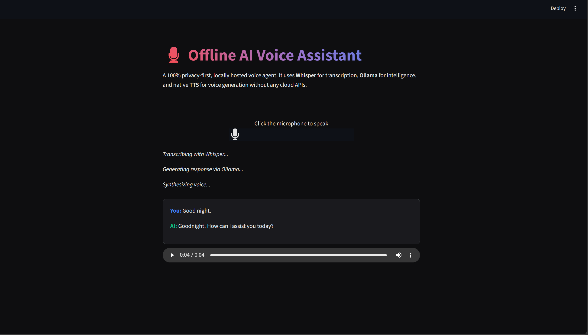

# 🎙️ AI-Powered Virtual Voice Assistant


A 100% local, privacy-first Voice-to-Voice AI assistant. This system integrates open-source speech recognition, highly efficient lightweight Large Language Models (SLMs), and offline text-to-speech synthesis into a seamless conversational interface.

## 📸 Output Demo
*The complete pipeline: Transcribing human speech, reasoning via a local Qwen2 model, and generating a spoken audio response.*



## 🚀 Key Features
*   **Local Speech-to-Text (STT):** Utilizes OpenAI's `Whisper` model running purely on local CPU/GPU hardware to transcribe microphone input with high accuracy.
*   **Self-Hosted Intelligence:** Connects to `Ollama` running a highly optimized lightweight model (`qwen2:0.5b`) to bypass cloud APIs, ensuring rapid responses with low memory footprint and complete data privacy.
*   **Offline Text-to-Speech (TTS):** Implements `pyttsx3` to tap into the native operating system's voice synthesizers, converting the LLM's text output back into spoken audio.
*   **Interactive Dashboard:** A sleek, dark-themed Streamlit interface featuring a browser-based audio recorder and real-time transcription logging.

## 📂 Repository Structure
```text
├── app.py                     # Streamlit UI and the complete Voice-to-Voice pipeline
└── requirements.txt           # Project dependencies
