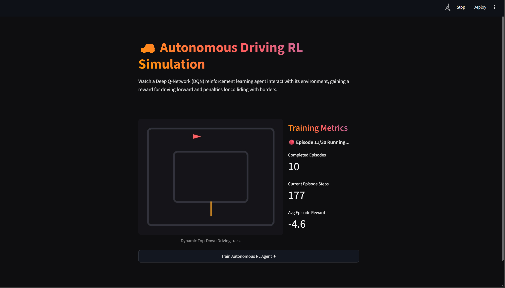

# 🚗 Autonomous Driving Simulation


An interactive, Physics-based 2D simulated training track and neural reinforcement learning engine designed to explore visual self-driving car control policies from scratch.

## 📸 Output Demo
*The Deep Q-Network agent actively learning to navigate the track and maximize rewards within the interactive dashboard.*



## 🚀 Key Features
*   **Deep Q-Network Model Architecture:** Employs a Custom deep network in PyTorch (`dqn_architecture.py`) optimized through a Target model architecture, Adam optimization, and Experience Replay to guarantee learning convergence.
*   **Simulation Physics with Pygame:** An on-the-fly rendering loop that creates a customizable visual race track, calculating dynamic car collisions and projecting multi-angle radar sensors for spatial feature mapping.
*   **Intuitive dashboard:** Visualized training steps, lap rewards, episode tracking, and exploration epsilon decay in an interactive, dark-themed dashboard.

## 📂 Repository Structure
```text
├── app.py                     # Streamlit dashboard & Pygame loop runner
├── dqn_architecture.py        # Custom Deep Q-Network configuration
├── requirements.txt           # Project dependencies
└── .gitignore                 # Excluded directories
