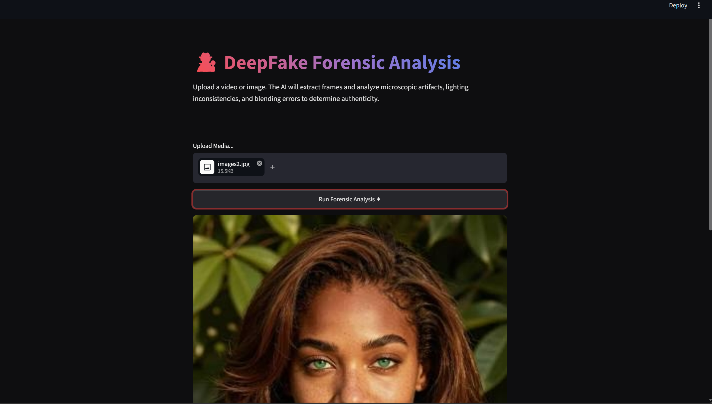
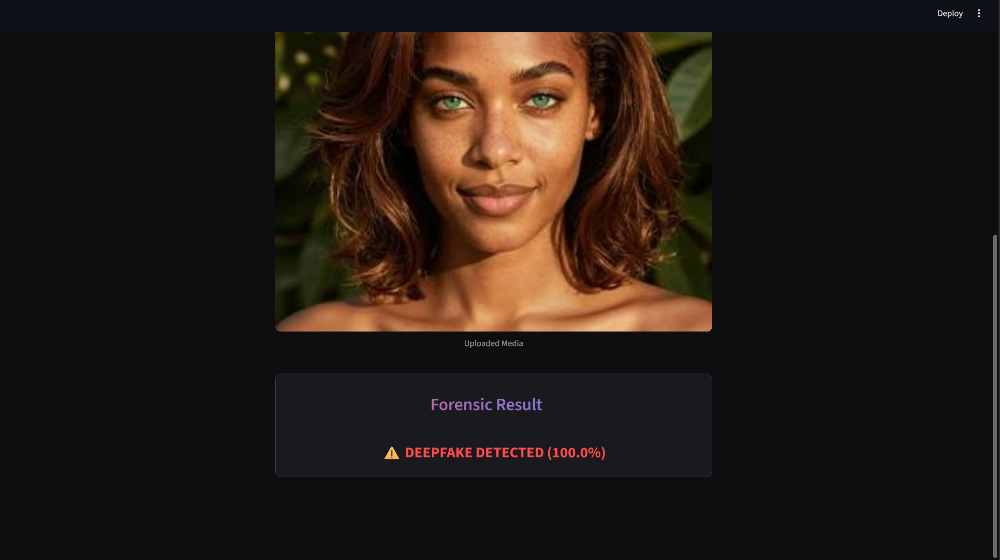

# 🕵️‍♂️ DeepFake Detection System


An advanced Vision-Language and Forensic AI web application designed to differentiate between authentic media and AI-generated DeepFakes by analyzing microscopic digital artifacts.

## 📸 Output Demo
*The forensic neural network analyzing both authentic and manipulated media to determine authenticity.*

<p align="center">
  
  
</p>

## 🚀 Key Features
*   **Spatio-Temporal Architecture Skills:** Includes `cnn_forensic_architecture.py`, demonstrating the implementation of a custom ResNeXt50 + LSTM neural network built from scratch in PyTorch to track unnatural blinking and temporal blending errors.
*   **Video Frame Extraction:** Utilizes `OpenCV` to parse uploaded `.mp4` video files, dynamically mapping and extracting temporal frames for batched neural network processing.
*   **Production Inference:** Deploys a highly accurate Hugging Face Vision Transformer (ViT) via an interactive, dark-themed Streamlit dashboard.

## 📂 Repository Structure
```text
├── app.py                         # Streamlit UI and inference pipeline
├── cnn_forensic_architecture.py   # Pure PyTorch CNN (ResNeXt) + RNN (LSTM) code
└── requirements.txt               # Project dependencies
