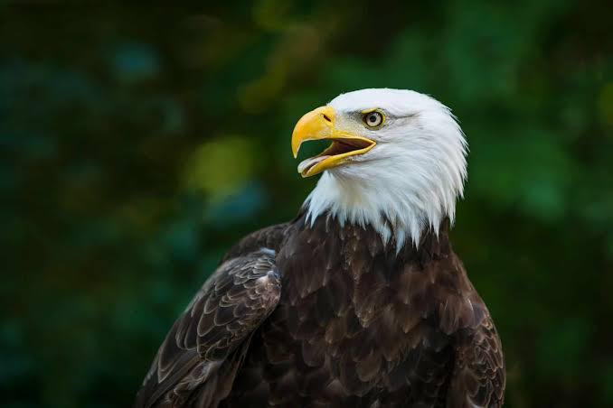

# 🖼️ AI Image Caption Generator


A deep learning Vision-Language web application that automatically generates descriptive natural language sentences for uploaded images.

## 🚀 Key Features
*   **Dual-Network Architecture Skills:** Includes `cnn_lstm_architecture.py` demonstrating how to build a visual feature extractor (ResNet50) merged with a recurrent text decoder (LSTM) from scratch in PyTorch.
*   **Production Inference:** The interactive Streamlit dashboard deploys the state-of-the-art BLIP (Bootstrapping Language-Image Pre-training) model via the Hugging Face `transformers` library for real-world, highly accurate captioning.
*   **Automated Preprocessing:** Utilizes `BlipProcessor` to handle image resizing, pixel normalization, and text tokenization natively.

## 📸 Output Demo
*The deep learning model successfully generating a descriptive natural language caption for a bald eagle.*



## 📂 Repository Structure
```text
├── app.py                       # Streamlit UI and Hugging Face inference pipeline
├── cnn_lstm_architecture.py     # Pure PyTorch CNN (ResNet) + RNN (LSTM) architecture
└── requirements.txt             # Project dependencies

