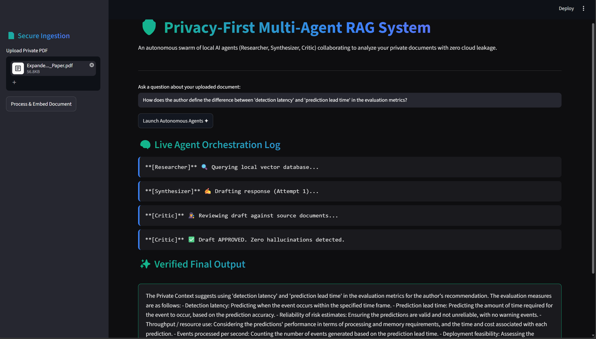

# 🛡️ Privacy-First Multi-Agent RAG System


An autonomous, 100% locally hosted Agentic AI system. Multiple specialized AI agents (Researcher, Synthesizer, Critic) collaborate in an iterative loop to retrieve, draft, and verify answers from private enterprise documents, guaranteeing zero data leakage to cloud APIs.

## 📸 Output Demo
*The live orchestration log showing the Critic Agent successfully preventing an AI hallucination, forcing the Synthesizer Agent to rewrite its output based purely on the local ChromaDB vector context.*



## 🚀 Key Features
*   **Multi-Agent Orchestration Loop:** Implements a strict autonomous workflow where a `Synthesizer` drafts responses and a `Critic` validates them against the source material, automatically triggering retries if hallucinations are detected.
*   **Local Vector Embeddings:** Utilizes `sentence-transformers` (all-MiniLM-L6-v2) to convert private PDFs into high-dimensional vectors, stored in a localized `Chroma` database.
*   **Zero-Leakage Local LLM:** Powered entirely by `Ollama` (Llama 3 or Qwen2), ensuring that highly sensitive proprietary codebases, HR reports, or financial PDFs never leave your machine's hardware.
*   **Live Reasoning Dashboard:** A Streamlit interface that exposes the internal "thought process" of the agent swarm in real-time, building trust in the final verified output.

## 📂 Repository Structure
```text
├── app.py                     # Streamlit UI & dynamic agent logging
├── agent_orchestrator.py      # RAG pipeline & multi-agent logic loop
├── requirements.txt           # Project dependencies
└── .gitignore                 # Excluded directories
